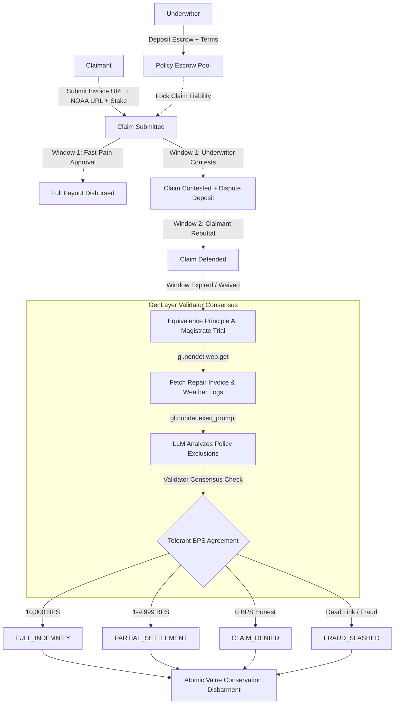

# DamageAssessCourt

> **Autonomous AI Insurance Damage Court & Continuous Basis Points Indemnity Protocol on GenLayer**

DamageAssessCourt is a decentralized property damage insurance court built on GenLayer. It replaces rigid binary parametric triggers with multi-validator AI consensus, cross-examining contractor repair invoices, ambiguous policy exclusions, and NOAA storm reports using continuous 0 to 10,000 Basis Points (BPS) indemnity mathematics.

---

## 1. Why GenLayer is Required

Traditional Web3 insurance protocols rely on naive binary parametric triggers: if a storm anemometer registers winds above 75 mph, the policy triggers a 100% payout; otherwise 0%.

In commercial real estate and property insurance, this model breaks down completely:

1. **Pre-Existing Wear vs. Sudden Catastrophe:** A hurricane may shear a warehouse roof membrane, but 30% of the contractor invoice replaces rusted structural beams that were already corroded before the storm.
2. **Ambiguous Policy Exclusion Clauses:** Policies cover sudden rainwater penetration following envelope opening, but explicitly exclude gradual rot, pre-existing rust, or cosmetic improvements.
3. **Non-Deterministic Judgment:** No static EVM smart contract or centralized oracle can parse contractor PDFs, photographs, and official NOAA logs without bias or single-point-of-failure risk.

### The GenLayer Solution
GenLayer Intelligent Contracts operate under the **Equivalence Principle**:
- **Non-Deterministic Web Ingestion:** Independent validators fetch official storm telemetry and contractor repair estimates directly over HTTPS using `gl.nondet.web.get`.
- **AI Magistrate Consensus:** Validators run an LLM prompt (`gl.nondet.exec_prompt`) assessing each line item against policy definitions.
- **Agreement Engine:** Consensus is enforced across canonical verdict classes and a 500 Basis Points (+/-5%) tolerance band.
- **Atomic Disbarment:** The contract mathematically disburses funds, refunds stakes, or executes fraud slashing without human custody.

---

## 2. Mathematical Engine & Exact Value Conservation

DamageAssessCourt enforces continuous 0 to 10,000 Basis Points ($0.01\%$ precision) settlement math with exact integer arithmetic:

$$\text{indemnity\_share} = \frac{\text{claimed\_amount} \times \text{settlement\_bps}}{10{,}000}$$

$$\text{insurer\_retained} = \text{claimed\_amount} - \text{indemnity\_share}$$

$$\text{indemnity\_share} + \text{insurer\_retained} \equiv \text{claimed\_amount}$$

### The 4 Canonical Verdict States

| Verdict | Basis Points (BPS) | Claimant Payout | Underwriter Outcome |
|---|---|---|---|
| **`FULL_INDEMNITY`** | `10,000` (100%) | 100% claim + stake returned + underwriter deposit | Underwriter deposit forfeited as contest penalty |
| **`PARTIAL_SETTLEMENT`** | `1 to 9,999` | Proportional indemnity + stake returned | Balance retained in pool + dispute deposit refunded |
| **`CLAIM_DENIED`** | `0` (0%) | Stake returned (honest claimant safeguard) | Full claim retained in pool + deposit refunded |
| **`FRAUD_SLASHED`** | `0` (Slashed) | Stake slashed into policy pool | Full claim retained in pool + deposit refunded |

---

## 3. Protocol Architecture



---

## 4. Live Studionet Deployment & Verification

DamageAssessCourt is live on **GenLayer Studionet (Chain ID 61999)**:

- **Contract Address:** [`0x1e4d9Ef20330636F289Aa550C2ED07030e5b93Fb`](https://studio.genlayer.com)
- **Deployment Transaction:** `0xeae4a8f6210dacaef5b0009579c8dabeae2031fb39f29d27fedaae47591e0966`
- **Deployer Account:** `0xB704b624ae5f776b3a3fA7496aDcdA4dB4DCAB56` (`9ytshade_Deployer`)
- **Contract Version:** `1.0.0`
- **Consensus Receipt:** Status `7` (`FINALIZED_ACCEPTED` by 5/5 validator consensus)

Full transaction receipts and multi-actor lifecycle evidence are documented in [`docs/STUDIONET_LIVE_RUN_REPORT.md`](file:///c:/Users/9ytshade/Desktop/Genlayer%20Intelligent%20Contracts/damageassesscourt/docs/STUDIONET_LIVE_RUN_REPORT.md).

---

## 5. Test Suite Verification

### Python Intelligent Contract Test Suite (Direct Mode)
- **Suite 1:** Core lifecycle tests ([`tests/direct/test_damageassesscourt.py`](file:///c:/Users/9ytshade/Desktop/Genlayer%20Intelligent%20Contracts/damageassesscourt/tests/direct/test_damageassesscourt.py)) - **16 of 16 passed**
- **Suite 2:** Adversarial stress and outage recovery ([`tests/direct/test_issues_recovery_and_agreement.py`](file:///c:/Users/9ytshade/Desktop/Genlayer%20Intelligent%20Contracts/damageassesscourt/tests/direct/test_issues_recovery_and_agreement.py)) - **6 of 6 passed**
- **Total:** **22 direct mode tests passing in 3.73 seconds**.

### TypeScript & Web Frontend Test Suite
- Unit & BPS math test suite ([`web/src/lib/safety.test.ts`](file:///c:/Users/9ytshade/Desktop/Genlayer%20Intelligent%20Contracts/damageassesscourt/web/src/lib/safety.test.ts)) - **12 of 12 passed**
- Next.js Turbopack production build: **Passed (0 errors)**
- ESLint verification: **Passed (0 errors)**

---

## 6. Project Structure

```
damageassesscourt/
├── contracts/
│   └── damageassesscourt.py        # Intelligent Contract (1,079 lines, GenVM certified)
├── docs/
│   ├── MVP_SPEC.md                 # Protocol architecture & specification
│   ├── CONTRACT_SPEC.md            # GenVM contract specification & invariants
│   └── STUDIONET_LIVE_RUN_REPORT.md # On-chain transaction receipts & consensus evidence
├── fixtures/
│   ├── sample_commercial_policy.json
│   ├── storm_damage_repair_estimate_2026.json
│   └── noaa_weather_storm_report_2026.json
├── scripts/
│   ├── deploy-damageassesscourt.mjs # Studionet deployment script
│   └── run-studionet-lifecycle.mjs  # Multi-actor live on-chain lifecycle runner
├── tests/
│   ├── conftest.py                 # Windows direct mode pytest harness
│   └── direct/
│       ├── test_damageassesscourt.py
│       └── test_issues_recovery_and_agreement.py
└── web/
    ├── src/
    │   ├── app/                    # Next.js App Router (Dashboard, Policies, Claims, Protocol)
    │   ├── components/             # Dovetail UI modals, cards, header, and visualizers
    │   ├── lib/                    # genlayer-js client, safety validators, wallet provider
    │   └── types/                  # TypeScript contract and BPS types
    ├── package.json
    └── tailwind.config.ts
```

---

## 7. Quickstart Guide

### 1. Prerequisites
- Python 3.12+ with GenLayer direct mode simulator
- Node.js v20+ with npm

### 2. Run Direct Mode Contract Tests
```powershell
cd damageassesscourt
& "..\proofpay\.venv\Scripts\pytest.exe" tests -q
```

### 3. Run Frontend Unit Tests & Dev Server
```powershell
cd damageassesscourt/web
npm run test
npm run dev
```

### 4. Run Studionet On-Chain Scenarios
```powershell
cd damageassesscourt
node scripts/run-studionet-lifecycle.mjs
```

---

## 8. License & Attribution

DamageAssessCourt is licensed under the MIT License. Developed for the GenLayer Ecosystem.
